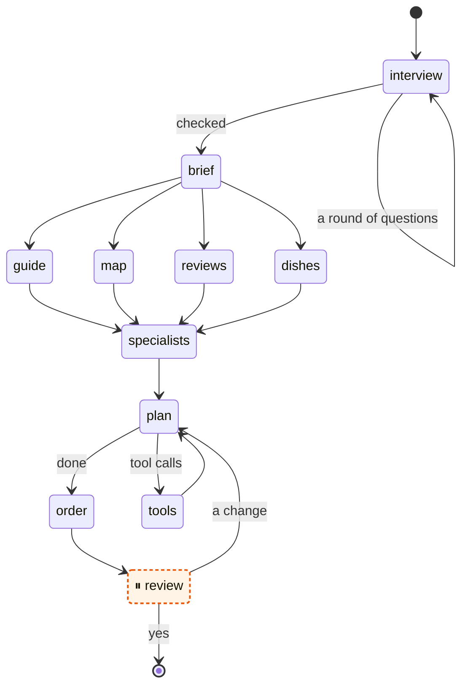

# Foodie Route

**Plan where to eat on a trip, at places where the people who live there eat.** You write where you
are going and what you like, and the planner asks what a food planner would: allergies, budget, who
is coming, how adventurous you are. An agent reads a travel guide, the street map and, if you want,
reviews, names what each place is known for, and draws a route of meals on a map. You can ask for
changes until you like it. In English, Spanish or Catalan.

**Try it: <https://deeptelar.github.io/telar-foodie/>.** Add the key of a model under Settings, or
[plan the sample](https://deeptelar.github.io/telar-foodie/?sample), which needs no key.

The whole app is one web page. There is no server behind it: the workflow runs in your browser, the
plan is saved in your browser, and the key of your model goes from your browser straight to its
provider. You can also speak instead of typing: the browser turns your voice into text with its own
speech service (Chrome's runs on Google's servers), and the page only gets the text. Firefox has
none, so there the microphone buttons are not shown. The page counts visits and a few steps, such
as a plan started or a route ready, with [GoatCounter](https://www.goatcounter.com/): without
cookies, and without anything of the trip
([`Visits.kt`](src/jsMain/kotlin/dev/deeptelar/foodie/Visits.kt)).

It is built with [Telar](https://github.com/deeptelar/telar), a Kotlin library for AI agents and
workflows, and is meant as an example of a complete app on it.

## The workflow

The planner is one graph over one state, [`Trip`](src/commonMain/kotlin/dev/deeptelar/foodie/Trip.kt).
All of it is in [`Planner.kt`](src/commonMain/kotlin/dev/deeptelar/foodie/Planner.kt), and Telar draws it with `topology.toMermaid()`; the run pauses at ⏸:



| Node | What it does | What of Telar it shows |
|---|---|---|
| `interview` | Asks the traveller what a food planner asks, a few questions at a time and allergies first, and reads the answers into a `Profile`. The topics are fixed in code; the model writes the questions for the places of the trip and skips what the request already says. Each round pauses the run, and at the end the traveller checks the profile. | A loop on one node with a conditional edge, `interrupt` in every round, `ask<Reading>` |
| `brief` | A model reads the request and the answers into a `Brief`, and the stops are found on the map, with where the traveller sleeps. When the request names no place, or the map does not know one, the run pauses with a question. | A typed answer with `ask<Brief>`, `interrupt` from inside a node, `Retry` |
| `guide`, `map`, `reviews` | The three sources are asked at the same time. `reviews` is only in the graph when there is a Google key. The map also gives the big sights, since a place a few metres from one lives off the visitors who pass. What a source answered is kept when the step runs again. | Parallel nodes with a `work` and an update, and no reducer; `effect` |
| `dishes` | A model names what each stop is known for, with what the guide says and the traveller's allergies, diet and season in front of it, and a line of history or custom for each dish. It runs beside the sources and waits only for the guide, which is read once for both; the page shows the dishes one at a time from then on, while the map is still searched and while the agent chooses. | A work node beside the sources, `ask<Menu>` in an `effect`, progress values |
| `specialists` | Searches the map for the places known for each dish, by the words the model gave with it, such as "francesinha" in a name or a cuisine, and with a Google key the reviews too ("best francesinha in Porto"). The agent reads these places first. | A node that every node of the step before leads to, so it runs once after all of them |
| `plan` ⇄ `tools` | An agent chooses a restaurant for each meal. Its tools search the sources again and write the route into the state. | `toolLoop` in a graph of your own, `StateTool`, a token budget |
| `order` | Sorts the meals and measures the walks between them, the first of a day from where the traveller sleeps. | A plain node |
| `review` | The run waits here for the traveller. A change goes back to the agent; a yes ends the run. | `interruptBefore`, `resume` with an update, a conditional edge that loops |

The sources run at the same time without a reducer. Each is a node with a `work`, the slow part,
which runs for all of them together, and an update, which adds what it found to the state one node
after the other, so no two updates meet. `effect` saves what a source answered with the step, so it
is not asked again after a reload. From `Planner.kt`, shortened:

```kotlin
val guide =
    node(
        Nodes.GUIDE,
        work = { trip ->
            gather(trip, trip.language.texts.theGuide) { stop ->
                val page = effect("guide ${stop.name}") { pages.get(stop.name) }
                Found(page.restaurants, guideNotes = mapOf(stop.name to page.text))
            }
        },
    ) { trip, found -> trip.with(found) }

// The brief leads to each source, and each source to the specialists, which run once after all of them.
listOfNotNull(guide, map, reviews, dishes).forEach { node -> brief then node then specialists }
```

Around the graph:

- **The plan survives a reload.** Every step is saved with `LocalStorageCheckpointer`. Close the
  page while the planner works, and it continues where it stopped. A source that had answered
  before the page was closed is not asked again: the street map is slow, and Google bills each
  search.
- **A plan goes into a file and back.** "Save the plan as a file" downloads the run's checkpoint
  with the trip as readable JSON: the request, the profile, the dishes, every candidate, the route
  and the agent's whole conversation, but no key. "Open a saved plan" puts the checkpoint back, and
  the run goes on from where it was saved
  ([`SavedPlan.kt`](src/commonMain/kotlin/dev/deeptelar/foodie/SavedPlan.kt)).
- **The traveller can pause the planner.** Pause cancels the run's job; what was saved stays.
  Words written then go with the run when it goes on
  ([`Pause.kt`](src/commonMain/kotlin/dev/deeptelar/foodie/Pause.kt)): before the route, they
  join the answers and the run starts again from the interview; once the agent plans, they are its
  next message, through `resume` with an update.
- **Planning is a conversation.** The page shows the request, the planner's questions and the
  answers as a chat, and the planner's next words below them.
- **The profile is the traveller's.** It has a tab of its own, apart from the conversation: every
  field can be changed or erased while the planner waits, and on a planned route a change goes to
  the agent. It is kept only in the browser, with the trip.
- **A planned route can change place by place.** "Change this place" on a meal asks why, with
  answers to tap (the dish, another kind of food, closer to somewhere, the price, touristy), and
  sends the changes of several meals to the agent as one message
  ([`Swap.kt`](src/commonMain/kotlin/dev/deeptelar/foodie/Swap.kt)). The places left are not
  chosen again. For each meal the agent offers two or three places with `offer_choices`, the one
  it recommends first and marked so, and the traveller taps one: nothing runs, the checkpoint
  takes the choice, and the agent hears of it with the traveller's next words. The agent can also change the days of a stop and add a place to the trip, with
  the tools `set_days` and `add_stop`, and its searches can look around a place with `near`.
- **The traveller can sleep in more than one place.** Each stop has its hotels by night, and the
  meals the traveller wants near where they sleep are checked against the place of that night.
- **The tools check what the agent puts on the route.** A restaurant used twice, a meal far from
  the hotel when the traveller wants it near, or a dish already ordered on another day comes back
  to the agent in the tool's result, to fix before it answers.
- **The route is made for a phone.** It shows one day at a time under a strip of days that stays
  at the top, the map and the cards point at each other, and a card opens for its details. A
  change runs with the route on the screen, and a cancelled one puts back the checkpoint saved
  before it.
- **The page shows the run live.** [`App.kt`](src/jsMain/kotlin/dev/deeptelar/foodie/App.kt)
  collects `stream()`: a node that starts, what it reports with `reportProgress`, the text of the
  model as it is written, and the tool calls of the agent.
- **A plan says what it cost.** The trip counts its tokens and its searches of Google Places in
  its state, and the end of the route prices them at the providers' list prices
  ([`Cost.kt`](src/commonMain/kotlin/dev/deeptelar/foodie/Cost.kt)): what an app that paid for its
  travellers' plans would pay. Seven days with two changes cost about $2.12 with Claude Opus 5.5.
- **The runs can be traced.** With the address of an OpenTelemetry collector in **Settings**, the
  `OtlpObserver` of `telar-otel` sends each run as a trace from the browser: a span for each step,
  with how long it took and what failed, and nothing of the trip.
- **A source that fails does not fail the trip.** The street map's public servers are busy now and
  then. The trip is then planned with what the other sources found, and says what is missing.
- **The tests need no key and no network.** [`PlannerTest`](src/commonTest/kotlin/dev/deeptelar/foodie/PlannerTest.kt)
  runs the whole graph with `ScriptedChatModel` of `telar-test`, on the JVM and in a browser.
  `graph.test { ... }` checks the path of a run step by step, the loop back from the review
  included.

## The sources

| Source | What it gives | Key |
|---|---|---|
| [Wikivoyage](https://en.wikivoyage.org/) | What a travel guide says about the food of a place, and the restaurants travellers list there, each with a few words | none |
| [OpenStreetMap](https://www.openstreetmap.org/), through Nominatim and the Overpass API | Where a place is, and the restaurants around it by their `cuisine` tag, without chains | none |
| [Google Places](https://developers.google.com/maps/documentation/places/web-service/text-search) | Restaurants for a search in words, with ratings | your own; Google bills its owner |

A restaurant that two sources know is one candidate with two sources, and counts for more.

What to know about them:

- None of them says whether a place is "authentic". The agent goes by what they do say: the
  cuisine, the guide's words, how many sources know the place, and the ratings. It is told to give
  its reason in the words of the sources, and to say so when little is known.
- A source can be out of date. Check the opening hours before you go.
- The free services are run for everyone. The page asks them a few times per trip; do not point
  heavy traffic at them.

## Run it

Telar comes from Maven Central. You need JDK 17 or later; the Gradle wrapper fetches the rest.

```bash
./gradlew jsBrowserDevelopmentRun --continuous   # the page, at http://localhost:8080
./gradlew jsBrowserDistribution                  # the page as files, in build/dist/js/productionExecutable
./gradlew jvmTest                                # the tests, on the JVM
./gradlew jsBrowserTest                          # the same tests in headless Chrome
FOODIE_LIVE=1 ./gradlew jvmTest                  # also asks the real guide and map for Lisbon
```

On the page, **Try the sample** plans two days in Lisbon without a key: a script stands in for the
model, and the sources answer what the real ones answered once, kept in
[`sample-sources.json`](src/jsMain/resources/sample-sources.json), so that a visitor's try asks
none of the free services. `FOODIE_RECORD=1 ./gradlew jvmTest --tests '*SampleRecordingTest*'`
asks them again. Open the page with `?sample` at the end of its address to start the sample at
once. For a trip of your own, add a key under **Settings**:

- **Claude**, with a key of the Anthropic API.
- **OpenAI, Gemini, Ollama** or another server with the API of OpenAI: its address, a model and a
  key. A local Ollama is at `http://localhost:11434/v1` and needs no key, but it has to allow the
  site of the page, or the browser stops its answers: start it with
  `OLLAMA_ORIGINS=https://deeptelar.github.io ollama serve`.
- Optionally a key for **Google Places**, for ratings. **Settings** shows how to get one, step by
  step; it is a key of the Places API (New), best restricted to the site of the page. Google's
  [guide](https://developers.google.com/maps/documentation/places/web-service/get-api-key) has the
  same steps.

The keys are kept in the `localStorage` of your browser. Anyone who can use your browser can read
them there, so use keys you can revoke.

## Where things are

```
src/commonMain   the planner: state, graph, tools, prompts, and the four sources
src/commonTest   its tests, with a scripted model and canned answers of the sources
src/jsMain       the page: settings, the live run, the route and the map
src/jvmTest      a check against the real sources
```

The map is drawn with [Leaflet](https://leafletjs.com/) (BSD 2-Clause), a copy of which is in
`src/jsMain/resources/vendor/leaflet`.

## Contributing

Contributions are welcome. The
[good first issues](https://github.com/deeptelar/telar-foodie/issues?q=is%3Aissue+is%3Aopen+label%3A%22good+first+issue%22)
are a place to start, and [CONTRIBUTING.md](CONTRIBUTING.md) says how to build, test and send a
change. None of it needs a key.

## License

[Apache License 2.0](LICENSE). The restaurants come from Wikivoyage
([CC BY-SA 4.0](https://creativecommons.org/licenses/by-sa/4.0/)) and from OpenStreetMap
([ODbL](https://www.openstreetmap.org/copyright)), and so do the answers that the sample keeps in
`sample-sources.json`, under the same licenses.
