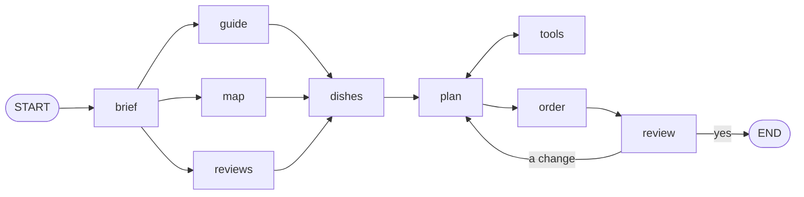

# Foodie Route

**Plan where to eat on a trip, at places where the people who live there eat.** You write where you
are going and what you like. An agent reads a travel guide, the street map and, if you want,
reviews, names what each place is known for, and draws a route of meals on a map. You can ask for
changes until you like it.

The whole app is one web page. There is no server behind it: the workflow runs in your browser, the
plan is saved in your browser, and the key of your model goes from your browser straight to its
provider.

It is built with [Telar](https://github.com/deeptelar/telar), a Kotlin library for AI agents and
workflows, and is meant as an example of a complete app on it.

## The workflow

The planner is one graph over one state, [`Trip`](src/commonMain/kotlin/dev/deeptelar/foodie/Trip.kt).
All of it is in [`Planner.kt`](src/commonMain/kotlin/dev/deeptelar/foodie/Planner.kt):



| Node | What it does | What of Telar it shows |
|---|---|---|
| `brief` | A model reads the request into a `Brief`, and the stops are found on the map. When the request names no place, or the map does not know one, the run pauses with a question. | A typed answer with `ask<Brief>`, `interrupt` from inside a node, `Retry` |
| `guide`, `map`, `reviews` | The three sources are asked at the same time. `reviews` is only in the graph when there is a Google key. What a source answered is kept when the step runs again. | Parallel nodes with a `work` and an update, and no reducer; `effect` |
| `dishes` | A model names what each stop is known for, with what the guide says in front of it. | `ask<Menu>` |
| `plan` ⇄ `tools` | An agent chooses a restaurant for each meal. Its tools search the sources again and write the route into the state. | `toolLoop` in a graph of your own, `StateTool`, a token budget |
| `order` | Sorts the meals and measures the walks between them. | A plain node |
| `review` | The run waits here for the traveller. A change goes back to the agent; a yes ends the run. | `interruptBefore`, `resume` with an update, a conditional edge that loops |

Around the graph:

- **The plan survives a reload.** Every step is saved with `LocalStorageCheckpointer`. Close the
  page while the planner works, and it continues where it stopped. A source that had answered
  before the page was closed is not asked again: the street map is slow, and Google bills each
  search.
- **The page shows the run live.** [`App.kt`](src/jsMain/kotlin/dev/deeptelar/foodie/App.kt)
  collects `stream()`: a node that starts, what it reports with `reportProgress`, the text of the
  model as it is written, and the tool calls of the agent.
- **A source that fails does not fail the trip.** The street map's public servers are busy now and
  then. The trip is then planned with what the other sources found, and says what is missing.
- **The tests need no key and no network.** [`PlannerTest`](src/commonTest/kotlin/dev/deeptelar/foodie/PlannerTest.kt)
  runs the whole graph with `ScriptedChatModel` of `telar-test`, on the JVM and in a browser.
  `graph.test { ... }` checks the path of a run step by step, the loop back from the review
  included.

## The sources

| Source | What it gives | Key |
|---|---|---|
| [Wikivoyage](https://en.wikivoyage.org/) | What a travel guide says about the food of a place, and the restaurants travellers list there, each with a few words | none |
| [OpenStreetMap](https://www.openstreetmap.org/), through Nominatim and the Overpass API | Where a place is, and the restaurants around it by their `cuisine` tag, without chains | none |
| [Google Places](https://developers.google.com/maps/documentation/places/web-service/text-search) | Restaurants for a search in words, with ratings | your own; Google bills its owner |

A restaurant that two sources know is one candidate with two sources, and counts for more.

What to know about them:

- None of them says whether a place is "authentic". The agent goes by what they do say: the
  cuisine, the guide's words, how many sources know the place, and the ratings. It is told to give
  its reason in the words of the sources, and to say so when little is known.
- A source can be out of date. Check the opening hours before you go.
- The free services are run for everyone. The page asks them a few times per trip; do not point
  heavy traffic at them.

## Run it

Telar comes from Maven Central. You need JDK 17 or later; the Gradle wrapper fetches the rest.

```bash
./gradlew jsBrowserDevelopmentRun --continuous   # the page, at http://localhost:8080
./gradlew jsBrowserDistribution                  # the page as files, in build/dist/js/productionExecutable
./gradlew jvmTest                                # the tests, on the JVM
./gradlew jsBrowserTest                          # the same tests in headless Chrome
FOODIE_LIVE=1 ./gradlew jvmTest                  # also asks the real guide and map for Lisbon
```

On the page, **Try the sample** plans two days in Lisbon without a key: a script stands in for the
model, and the sources it searches are the real ones. Open the page with `?sample` at the end of
its address to start the sample at once. For a trip of your own, add a key under **Settings**:

- **Claude**, with a key of the Anthropic API.
- **OpenAI, Gemini, Ollama** or another server with the API of OpenAI: its address, a model and a
  key. A local Ollama needs no key.
- Optionally a key for **Google Places**, for ratings.

The keys are kept in the `localStorage` of your browser. Anyone who can use your browser can read
them there, so use keys you can revoke.

## Where things are

```
src/commonMain   the planner: state, graph, tools, prompts, and the four sources
src/commonTest   its tests, with a scripted model and canned answers of the sources
src/jsMain       the page: settings, the live run, the route and the map
src/jvmTest      a check against the real sources
```

The map is drawn with [Leaflet](https://leafletjs.com/) (BSD 2-Clause), a copy of which is in
`src/jsMain/resources/vendor/leaflet`.

## License

[Apache License 2.0](LICENSE). The restaurants come from Wikivoyage
([CC BY-SA 4.0](https://creativecommons.org/licenses/by-sa/4.0/)) and from OpenStreetMap
([ODbL](https://www.openstreetmap.org/copyright)).
